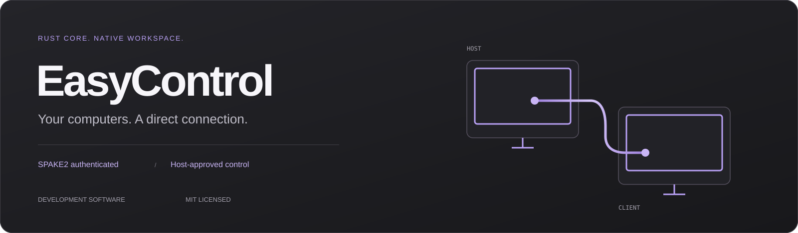
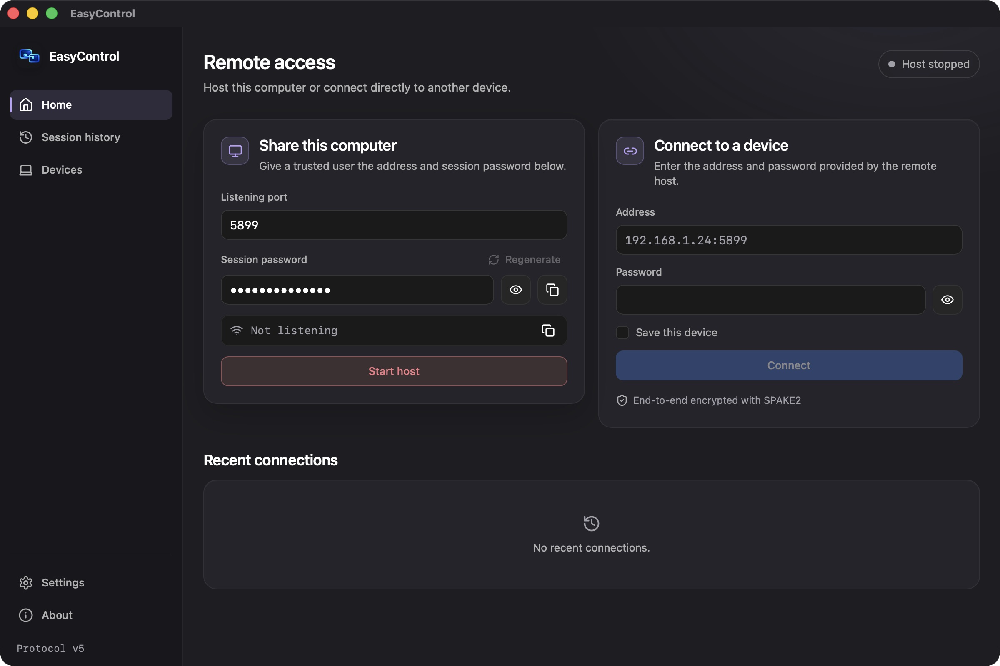
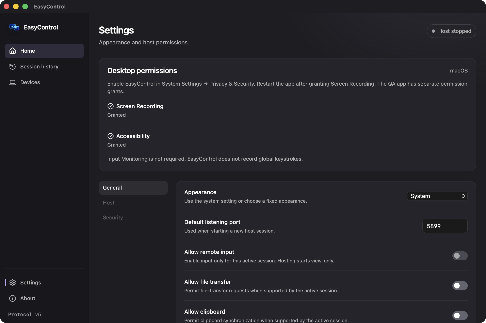
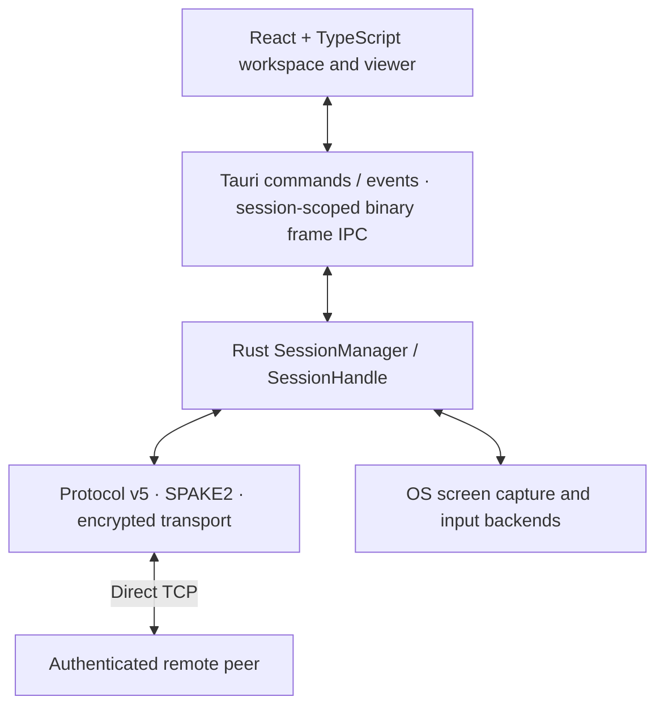

<p align="center">
  
</p>

<h1 align="center">EasyControl</h1>

<p align="center"><strong>Direct remote desktop. A Rust engine. A native workspace.</strong></p>

<p align="center">
  <a href="https://udhaybhat00.github.io/easycontrol-website/">Website</a> ·
  <a href="https://udhaybhat00.github.io/easycontrol-website/docs.html">Documentation</a> ·
  <a href="#quick-start">Quick start</a> ·
  <a href="docs/QA-2026-10-28.md">QA report</a> ·
  <a href="CONTRIBUTING.md">Contribute</a>
</p>



EasyControl is an MIT-licensed remote-desktop application built with **Rust, Tauri 2, React and TypeScript**. A host shares a LAN address and session password; a client connects directly, authenticates with SPAKE2 and receives encrypted screen frames. The host remains responsible for approving remote input.

| Application | Protocol | License | Release status |
| :-- | :-- | :-- | :-- |
| Rust + Tauri 2 | v5 | [MIT](LICENSE) | Development · 0.1.0 |

> [!IMPORTANT]
> **This is development software, not a production-ready release.** Real macOS capture and rendering have been observed. Controlled real input, extended two-machine QA, distribution signing and notarization remain release gates. No public signed installer is available yet. See [validation](#validation-and-release-status).

Latest follow-up: [release hardening — 30 October 2026](docs/HARDENING-2026-10-30.md), including dependency audits, additional regressions and the fail-closed macOS distribution gate.

## Contents

- [The workspace](#the-workspace)
- [Capabilities](#capabilities)
- [Quick start](#quick-start)
- [Your first session](#your-first-session)
- [macOS permissions](#macos-permissions)
- [Architecture](#architecture)
- [Repository structure](#repository-structure)
- [Development and validation](#development-and-validation)
- [Isolated QA application](#isolated-qa-application)
- [Validation and release status](#validation-and-release-status)
- [Troubleshooting](#troubleshooting)
- [Website](#website)
- [Contributing and security](#contributing-and-security)
- [Credits and license](#credits-and-license)

## The workspace



*Actual idle-state application screenshot: host stopped, no saved connection history, passwords hidden. The address in the input is a placeholder, not a connected peer.*

<details>
<summary><strong>View macOS permission and appearance settings</strong></summary>



*Screen Recording and Accessibility grants are reported by the OS. Remote input remains off while there is no approved active session.*

</details>

## Capabilities

| Area | Implemented behavior |
| :-- | :-- |
| Direct sessions | Numeric IP address + port, host/client lifecycle, wrong-password retry and disconnect cleanup |
| Authentication | SPAKE2 password authentication with encrypted key confirmation |
| Encryption | Protocol v5, ChaCha20-Poly1305, directional key material and HKDF-SHA256 |
| Live viewer | Actual RGBA frames through bounded native binary IPC; fit/original modes, monitor inventory and frame statistics |
| Remote input | Host-enforced default deny, explicit approve/revoke controls, coordinate/key mapping and held-input cleanup |
| Local workspace | Saved device addresses, recent authenticated sessions and Light / Dark / System appearance |
| Platform permissions | Real macOS Screen Recording / Accessibility state and user guidance |
| Developer QA | Separate QA app identity and storage namespace, reusing the same engine |

**Scope matters:** implementing an input backend is different from validating real injected input. Clipboard, chat, file-transfer and relay modules exist in the Rust core; complete desktop workflows or deployed cloud infrastructure are not provided.

There is no global device-ID service, account requirement, device discovery or automatic NAT traversal in the desktop app. Passwords are never saved with device/history entries.

## Quick start

### Prerequisites

- Rust stable with Cargo, rustfmt and Clippy.
- Node.js **22.12+** and npm.
- Native [Tauri prerequisites](https://v2.tauri.app/start/prerequisites/) for your platform.
- On macOS, Xcode Command Line Tools and the permissions described below.
- Access to the application repository, which is currently private. The public website repository contains no application source.

### Clone and validate the engine

```bash
git clone https://github.com/udhaybhat00/easycontrol.git
cd easycontrol

cargo check --all-features
cargo test --all-features
```

### Run the desktop app

```bash
cd desktop
npm ci
npm run tauri:dev
```

This starts Vite and the Tauri desktop shell together. A browser-only frontend is not a working remote-desktop client: session commands require the native Rust bridge.

### Build a macOS app and DMG

From `desktop/`:

```bash
npm run tauri:build
```

Typical Apple Silicon output:

```text
desktop/src-tauri/target/release/bundle/
├── macos/EasyControl.app
└── dmg/EasyControl_0.1.0_aarch64.dmg
```

Architecture-specific filenames depend on the target. A debug app build uses `npm run tauri:build -- --debug --bundles app` and writes under `target/debug/` instead.

> [!NOTE]
> Local builds default to ad-hoc signing. For repeat macOS permission testing, supply the **same Apple Development identity** through `APPLE_SIGNING_IDENTITY` on each build. Replacing an ad-hoc-signed app can invalidate its grants. Apple Development signing is not public distribution signing; releases still need Developer ID signing, notarization and clean-machine checks. Keep certificates and signing credentials out of Git. See [Tauri’s signing guide](https://v2.tauri.app/distribute/sign/macos/).

## Your first session

1. **On the host:** open Home → Share this computer. Keep the default port `5899`, or choose another available port from `1024–65535`.
2. **Start hosting:** the displayed endpoint changes from “Not listening” to the real LAN address. Copy it and share the session password through a trusted channel.
3. **On the client:** enter the host’s numeric `IP:port` and password, then connect.
4. **Verify the screen:** authentication begins a view-only session. Screen capture requires the host’s Screen Recording grant.
5. **Approve control when appropriate:** the host can approve input during the authenticated session. The client must also enable sending input; its checkbox cannot grant itself host permissions.
6. **End access:** revoke input or disconnect from either side. After a session ends, the desktop host returns to stopped; start hosting again for another session.

For same-Mac QA, use `127.0.0.1:5899` from the isolated QA client. Between machines, use the actual host’s LAN endpoint. The machines need a reachable network path.

The default is **5899**, avoiding the conventional VNC/macOS Screen Sharing port **5900**.

## macOS permissions

Open **System Settings → Privacy & Security** and approve the exact installed host application.

| Permission | Purpose |
| :-- | :-- |
| Screen Recording | Required on the host for actual desktop capture. Quit and reopen after granting it. |
| Accessibility | Required on the host before approved mouse/keyboard injection. |
| Input Monitoring | Not required by the current backend; EasyControl does not observe global keystrokes. |

EasyControl does not bypass OS security controls. A listening host is not proof that capture is authorized. The Settings screen reports actual grants; sharing status reflects capture activity.

The QA app has its own identity and grants. A client that only views frames does not require host capture/input grants.

## Architecture



The frontend is a control surface. Networking, authentication, encryption and session ownership stay in Rust. Screen frames cross bounded native IPC; there is no unauthenticated HTTP/WebSocket frame server.

The core exposes `SessionManager`, `SessionHandle`, `SessionConfig`, `SessionCommand`, `SessionEvent` and `SessionState`. The desktop bridge scopes viewer operations to the active session and rejects stale-session commands.

### Cargo features

| Feature | Purpose |
| :-- | :-- |
| `capture` | OS screen-capture backend through xcap |
| `input` | OS input backend through Enigo |
| `compression` | zstd frame compression |
| `crypto` | Retained compatibility feature; SPAKE2 and session encryption are always enabled. An unused legacy x25519 dependency was removed after a RustSec advisory. |

The desktop crate enables capture, input and compression. Run `cargo run -- --help` for the headless CLI; it is separate from the graphical viewer.

## Repository structure

```text
easycontrol/
├── src/
│   ├── lib.rs                   Public Rust engine exports
│   ├── main.rs                  CLI entry point
│   ├── cli.rs                   Headless host/client/relay commands
│   ├── session.rs               Session API and worker lifecycle
│   ├── session/tests.rs         Authentication and integration regressions
│   ├── transport.rs             Framed transport and handshakes
│   ├── protocol.rs              Versioned messages and compression bounds
│   ├── crypto.rs                Key derivation and session ciphers
│   ├── screen.rs                OS capture and monitor inventory
│   ├── input.rs                 Input mapping, permissions and held keys
│   ├── clipboard.rs             Core clipboard integration
│   ├── file_transfer.rs         Core file operations and containment
│   └── relay.rs                 Relay core; not a hosted service
├── tests/
│   └── session_loopback.rs      Public API loopback integration
├── desktop/
│   ├── src/
│   │   ├── App.tsx              Dashboard, history, devices and settings
│   │   ├── HostPanel.tsx        Host approval and revocation
│   │   ├── PermissionPanel.tsx  macOS grant status and guidance
│   │   ├── RemoteViewer.tsx     Actual frame rendering and input forwarding
│   │   ├── bridge.ts            Typed native commands and frame decoding
│   │   ├── keymap.ts            Keyboard mapping
│   │   ├── viewer-utils.ts      Coordinate, wheel and address helpers
│   │   └── production.css      Shared graphite/lavender themes
│   ├── tests/viewer.test.mjs    Frontend regression coverage
│   └── src-tauri/
│       ├── src/main.rs          Native session/IPC bridge
│       ├── src/permissions.rs   macOS permission APIs
│       ├── tauri.conf.json      Production app configuration
│       └── tauri.qa.conf.json   Isolated development QA profile
├── website/                    Product website and public documentation
├── docs/
│   ├── assets/banner.svg       Project artwork
│   └── QA-2026-10-28.md         Evidence, measurements and release gates
├── .github/workflows/          macOS validation
├── CONTRIBUTING.md
├── SECURITY.md
├── CHANGELOG.md
└── LICENSE
```

## Development and validation

Run from the repository root:

```bash
cargo fmt --check
cargo check --all-features
cargo test --all-features
cargo clippy --all-features -- -D warnings
cargo build --release --all-features

cargo fmt --manifest-path desktop/src-tauri/Cargo.toml --check
cargo test --manifest-path desktop/src-tauri/Cargo.toml
cargo clippy --manifest-path desktop/src-tauri/Cargo.toml -- -D warnings
```

Then from `desktop/`:

```bash
npm test
npm run build
```

The [macOS workflow](.github/workflows/validate.yml) automates these checks and an app build. A workflow definition is not evidence that a hosted run has passed.

## Isolated QA application

From `desktop/`:

```bash
npm run tauri:build -- --bundles app \
  --config src-tauri/tauri.qa.conf.json
```

| Profile | Bundle identifier | Browser storage namespace |
| :-- | :-- | :-- |
| Production | `com.easycontrol.desktop` | `easycontrol` |
| QA | `com.easycontrol.desktop.qa` | `easycontrol.qa` |

Both use the same Rust engine and frontend. QA does not overwrite production appearance, saved devices or recent history. Do not ship QA configuration as the production app.

Keep **Send input unchecked** during recursive same-Mac screen capture unless an explicitly approved controlled test is in place. A second authorized machine is preferable for actual input validation.

## Validation and release status

**Local baseline recorded 28 October 2026:** 49 passing tests; 1 permission-dependent capture test ignored.

| Suite / check | Observed result |
| :-- | :-- |
| Rust core | 37 library + 1 public API integration passed; 1 ignored |
| Tauri bridge | 5 tests passed |
| Frontend | 6 tests passed |
| Format, checks and strict Clippy | Passed |
| Core release / frontend production builds | Passed |
| Optimized macOS production and QA app builds | Passed |
| DMG build / checksum | Passed |
| Real authentication, capture and rendering | Observed on macOS |
| Host approve/revoke workflow | Observed; input backend initialized |
| Actual injected mouse/keyboard and revoked-input attempts | **Not tested** |
| Fullscreen / multiple physical monitors | Automation blocked / not tested |
| Windows and Linux desktop releases | **Not validated** |
| Developer ID, notarization and clean-machine install | **Outstanding** |

Observed same-Mac frames were **2880×1800**, up to **10 FPS**. Background viewer FPS varied and native unread-frame replacements occurred. Sampled native host CPU was about **27%** and client **12–22%**, excluding WebKit/helpers. These are initial observations, not a cross-platform performance guarantee or end-to-end latency benchmark.

See the [full QA report](docs/QA-2026-10-28.md) for the PASS / BLOCKED / NOT TESTED matrix, actual sample boundaries, confirmed fixes and remaining release gates. Automated mock-backend tests do not prove real OS capture or input.

## Troubleshooting

<details>
<summary><strong>Host cannot start or bind port 5899</strong></summary>

Check for an existing EasyControl listener or another service using the port. Stop only processes you own, or choose another available port in 1024–65535. On macOS, `lsof -nP -iTCP:5899` can identify a listener.

</details>

<details>
<summary><strong>Connection refused, timeout or authentication failure</strong></summary>

Confirm the host is actually listening, the IP/port match its displayed endpoint and both machines have a working network path. A handshake MAC mismatch can indicate the wrong password. A rejected password should leave the listener available for a correct retry.

</details>

<details>
<summary><strong>Authenticated but no frames, or wallpaper-only capture</strong></summary>

Check Screen Recording for the exact installed host app and restart after granting it. Stale/ad-hoc signing identities can invalidate previous grants. Wallpaper-only output is not proof of authorized full-desktop capture.

</details>

<details>
<summary><strong>Screen visible but input is denied</strong></summary>

Check host Accessibility, host approval, client Send input and viewer focus. The client cannot approve itself. Actual injected input validation remains outstanding; do not interpret mock tests as proof of real OS input.

</details>

<details>
<summary><strong>A source link returns 404</strong></summary>

The application repository currently requires access. Sign in using an authorized account or contact the maintainer. The separate public website repository does not contain application code.

</details>

## Website

**[Visit the website](https://udhaybhat00.github.io/easycontrol-website/)** · [Public website source](https://github.com/udhaybhat00/easycontrol-website)

The dependency-free static site lives in `website/` and is published from a separate public repository, preserving the application repository’s privacy. It includes actual screenshots, a build/usage guide, architecture and validation details, search, copy buttons, responsive navigation, reduced-motion support and System/Light/Dark appearance.

```bash
cd website
npm test
npm run build
npm run dev
```

The preview runs at `http://127.0.0.1:4173`. It is a product/documentation website, not a remote-desktop frontend.

## Contributing and security

Read [CONTRIBUTING.md](CONTRIBUTING.md) for setup, test expectations and focused PR guidance. See [CHANGELOG.md](CHANGELOG.md) for unreleased changes.

Report sensitive findings through the private process in [SECURITY.md](SECURITY.md). Do not attach real passwords, session keys, captured private screens or clipboard contents.

Independent security review, two-machine soak/recovery testing, real input validation and public distribution checks remain necessary. Encryption does not replace those release gates.

## Credits and license

Created and maintained by **[Udhay Bhat](https://github.com/udhaybhat00)** · [LinkedIn](https://in.linkedin.com/in/udhaybhat).

Built with [Rust](https://www.rust-lang.org/), [Tauri](https://tauri.app/), [React](https://react.dev/), [TypeScript](https://www.typescriptlang.org/), [Vite](https://vite.dev/) and [Lucide](https://lucide.dev/). Third-party dependencies retain their respective licenses.

EasyControl is available under the **[MIT License](LICENSE)**. Copyright © 2026 Udhay Bhat.
